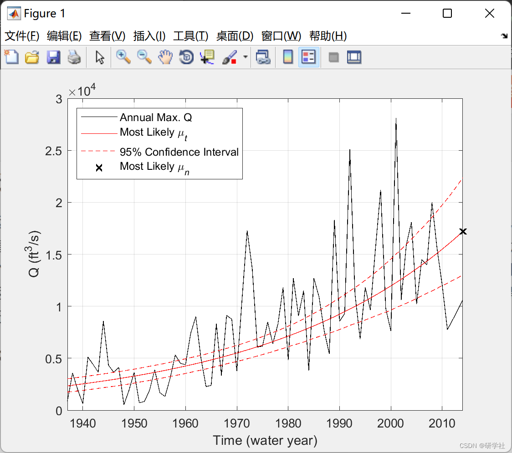
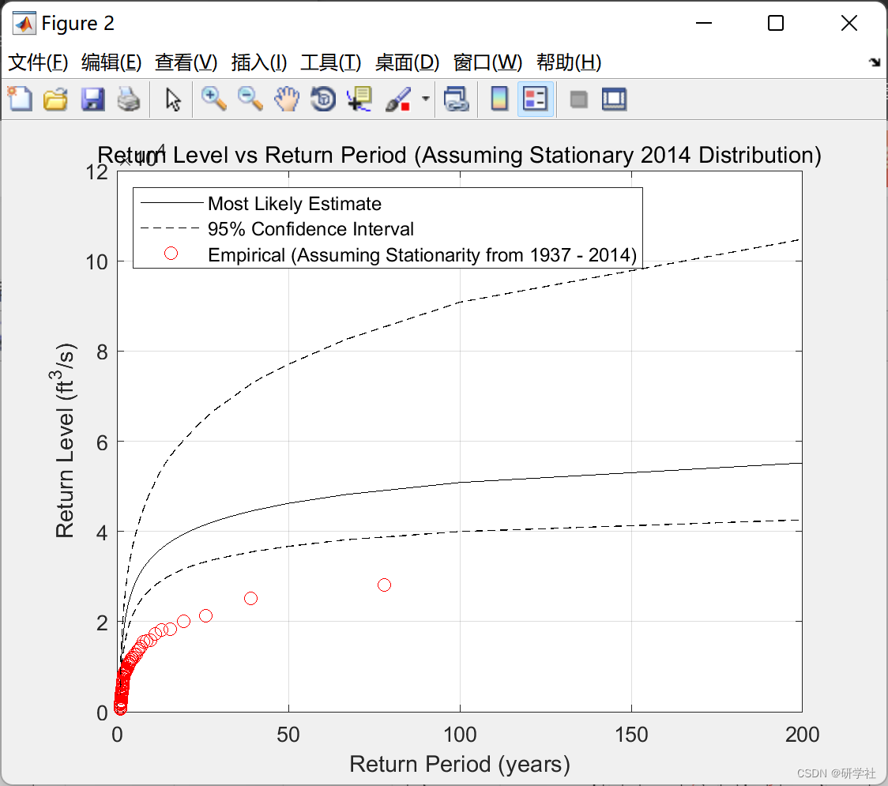
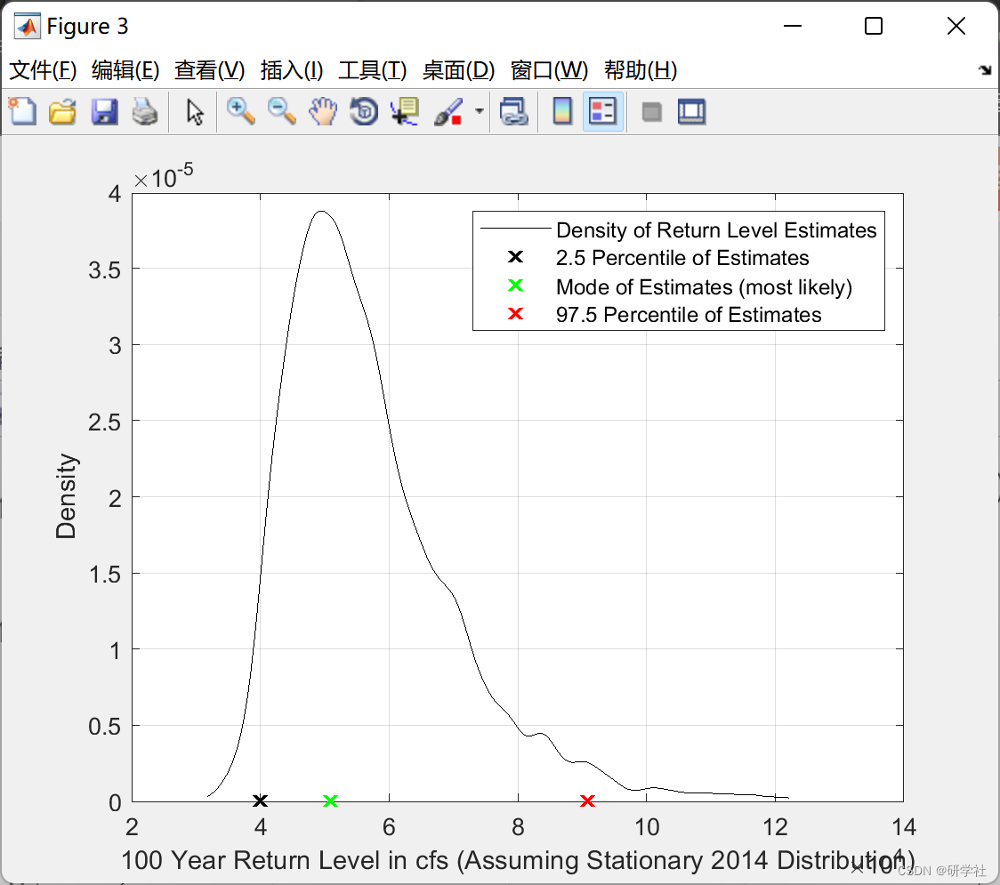

# Bayesian inference-based estimation of steady-state (ST) and non-steady-state (NS) LPIII model distributions fitted to peak discharges (Matlab code implementation)

🏆 Bloggers' Advantage: 🌞🌞🌞 The content of the blog strives to be rigorous in thought and clear in logic, for the convenience of readers.
⛳️ Mantra: A journey of a thousand miles is made in the ninetieth mile.
📋📋📋 This article's table of contents is as follows: 🎁🎁🎁 Table of Contents💥1 Overview📚2 Run Results🎉3 References🌈4 MATLAB Code Implementation
​Edit💥1 Overview In the NS model, the mean of the LPIII distribution changes over time. The return period is not calculated in the true sense of non-stationarity but rather based on a fixed value for the mean. In other words, assuming that the distribution remains constant over time, the calculation of the return period is performed. By default, when applying bayes_LPIII to estimate parameters of the NS LPIII model, the updated ST return period is calculated and displayed. The updated ST return period is obtained by calculating the return period related to the end of the fitting period, assuming that the distribution remains constant after recording ends.
📚2 Run Results​ Edit
​Edit  
​Edit  
Partial code:  
cf = 1;          %Multiplication factor to convert input Q to ft^3/s  
Mj = 2;          %1 for ST LPIII, 2 for NS LPIII with linear trend in mu  
y_r = 0;          %Regional estimate of gamma (skew coefficient)  
SD_yr = 0.55;     %Standard deviation of the regional estimate
%Prior distributions (input MATLAB abbreviation of distribution name used in  
%function call, i.e 'norm' for normal distribution as in 'normpdf')  
marg_prior{1,1} = 'norm';  
marg_prior{1,2} = 'unif';  
marg_prior{1,3} = 'unif';  
marg_prior{1,4} = 'unif';  
%Hyper-parameters of prior distributions (input in order of use with  
%function call, i.e [mu, sigma] for normpdf(mu,sigma))  
marg_par(:,1) = [y_r, SD_yr]'; %mean and std of informative prior on gamma  
marg_par(:,2) = [0, 6]';    %lower and upper bound of uniform prior on scale  
marg_par(:,3) = [-10, 10]';  %lower and upper bound of uniform prior on location  
marg_par(:,4) = [-0.15, 0.15]'; %lower and upper bound of uniform prior on trend  
%DREAM_(ZS) Variables  
if Mj == 1; d = 3; end     %define number of parameters based on model  
if Mj == 2; d = 4; end  
N = 3;             %number of Markov chains  
T = 8000;           %number of generations  
%create function to initialize from prior  
prior_draw = @(r,d)prior_rnd(r,d,marg_prior,marg_par);  
%create function to compute prior density  
prior_density = @(params)prior_pdf(params,d,marg_prior,marg_par);  
%create function to compute unnormalized posterior density  
post_density = @(params)post_pdf(params,data,cf,Mj,prior_density);  
%call the DREAM_ZS algorithm  
%Markov chains | post. density | archive of past states  
[x,       p_x,     Z] = dream_zs(prior_draw,post_density,N,T,d,marg_prior,marg_par);  
%% Post Processing and Figures  
%options:  
%Which mu_t for calculating return level vs. return period? (don't change  
%for estimates corresponding ti distribution at end of record, or updated ST distribution)  
t = data(:,1) - min(data(:,1));               %time (in years from the start of the fitting period)  
idx_mu_n = size(t,1);                    %calculates and plots RL vs RP for mu_t associated with t(idx_mu_n)  
%(idx_mu_n = size(t,1) for uST distribution)  
%Which return level for denisty plot?  
sRP = 100;                         %plots density of return level estimates for this return period  
%Which return periods for output table?           %outputs table of return level estimates for these return periods  
RP_out =[200; 100; 50; 25; 10; 5; 2];  
%end options  
%apply burn in (use only half of each chain) and rearrange chains to one sample  
x1 = x(round(T/2)+1:end,:,:);                %burn in  
p_x1 = p_x(round(T/2)+1:end,:,:);  
post_sample = reshape(permute(x1,[1 3 2]),size(x1,1)*N,d,1); %columns are marginal posterior samples  
sample_density = reshape(p_x1,size(p_x1,1)*N,1);      %corresponding unnormalized density  
%find MAP estimate of theta  
idx_theta_MAP = max(find(sample_density == max(sample_density)));  
theta_MAP = post_sample(idx_theta_MAP,:);          %most likely parameter estimate  
%Compute mu as a function of time and credible intervals  
if Mj == 1; mu_t = repmat(post_sample(:,3),1,length(t));end %ST model, mu is constant  
if Mj == 2; mu_t = repmat(post_sample(:,3),1,length(t)) + post_sample(:,4)*t';end %NS mu = f(t)  
MAP_mu_t = mu_t(idx_theta_MAP,:);              %most likely estimate of the location parameter  
low_mu_t = prctile(mu_t,2.5,1);               %2.5 percentile of location parameter  
high_mu_t = prctile(mu_t,97.5,1);              %97.5 percentile of location parameter  
%compute quantiles of the LPIII distribution  
p = 0.01:0.005:0.995;                    %1st - 99.5th quantile (1 - 200 year RP)  
a=1;  
RLs = nan(size(post_sample,1),size(p,2));  
for i = 1:size(post_sample,1);               %compute return levels for each posterior sample  
RLs(i,:) = lp3inv(p,post_sample(i,1),post_sample(i,2),mu_t(i,idx_mu_n));  
a = a+1;  
if a == round(size(post_sample,1)/10) || i == size(post_sample,1);  
clc  
disp(['Calculating Return Levels ' num2str(round(i/size(post_sample,1)*100)) '% complete'])  
a = 1;  
end  
end  
MAP_RL = RLs(idx_theta_MAP,:);               %Return levels associated with most likely parameter estimate  
low_RL = prctile(RLs,2.5,1);                %2.5 percentile of return level estimates  
high_RL = prctile(RLs,97.5,1);               %97.5 percentile of return level estimates  
🎉3 References
🌈4 Matlab code implementation

## Images

<!-- PAYMENT_BLOCK -->

## Get this dataset

- Payment link (Stripe): [Buy now](https://buy.stripe.com/3cs8yP7sY87d0vu9AB)
- Payment QR code: 

<!-- /PAYMENT_BLOCK -->
